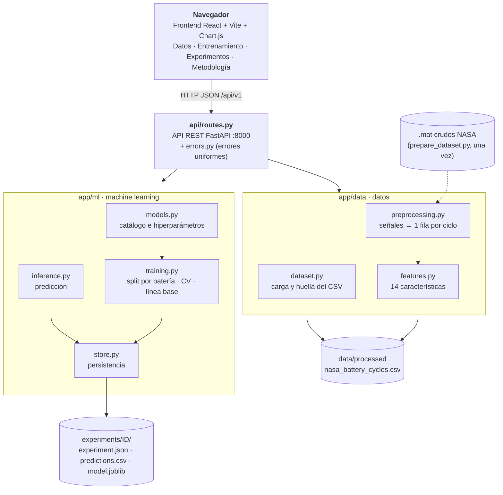
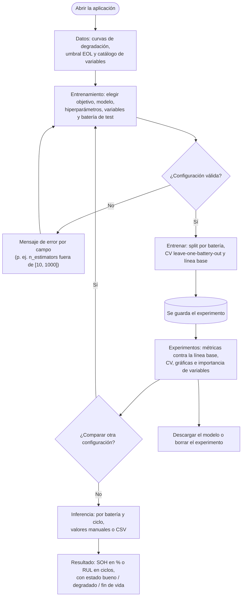
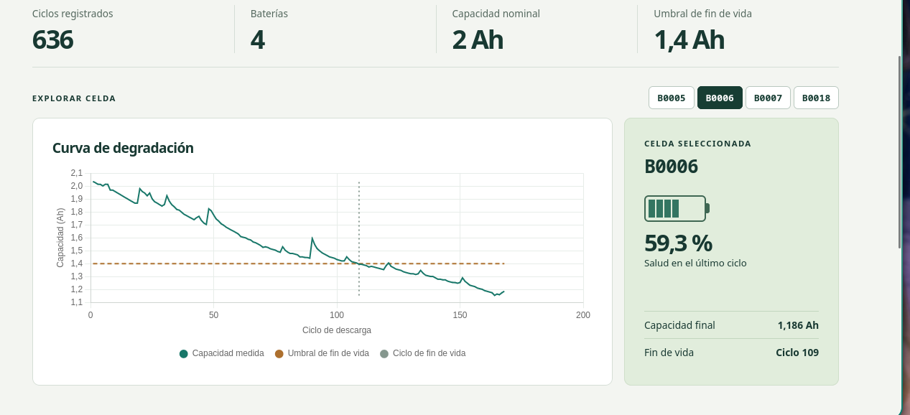
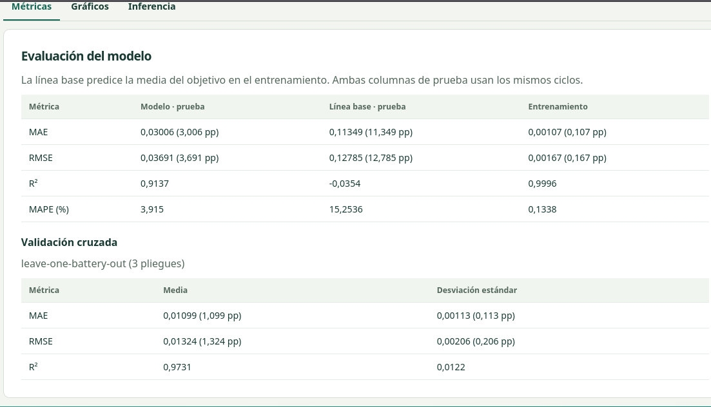
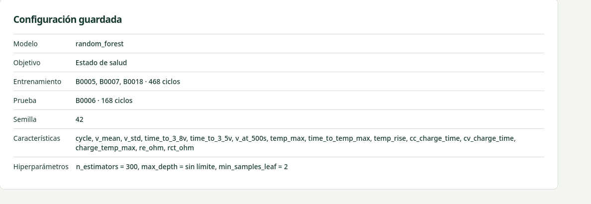
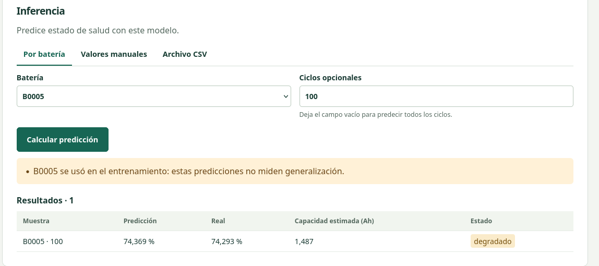
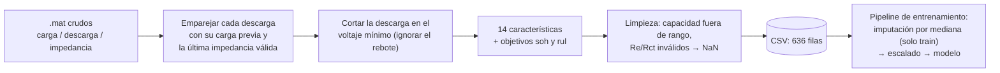
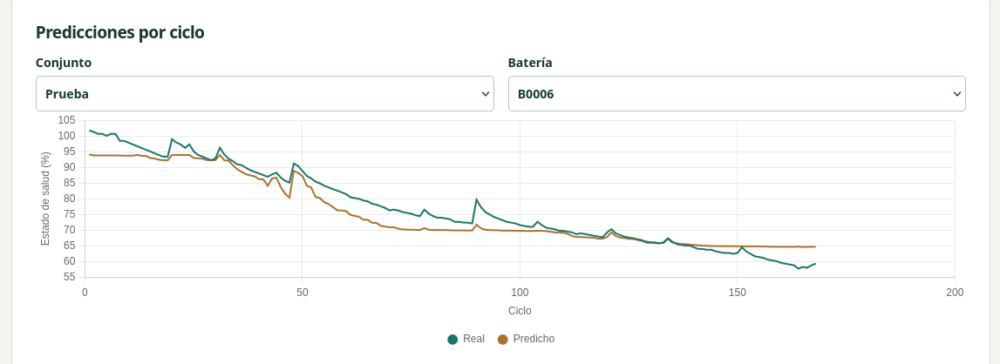
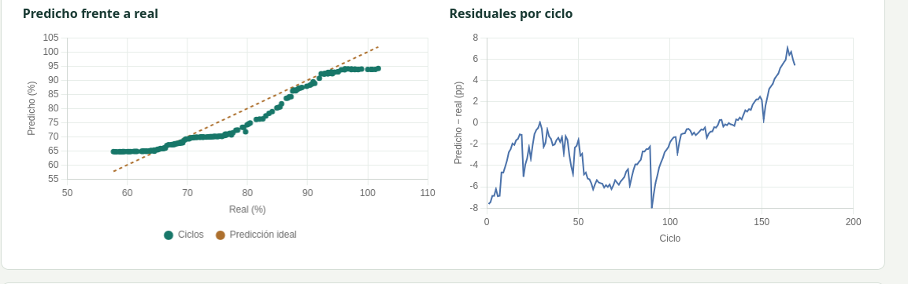
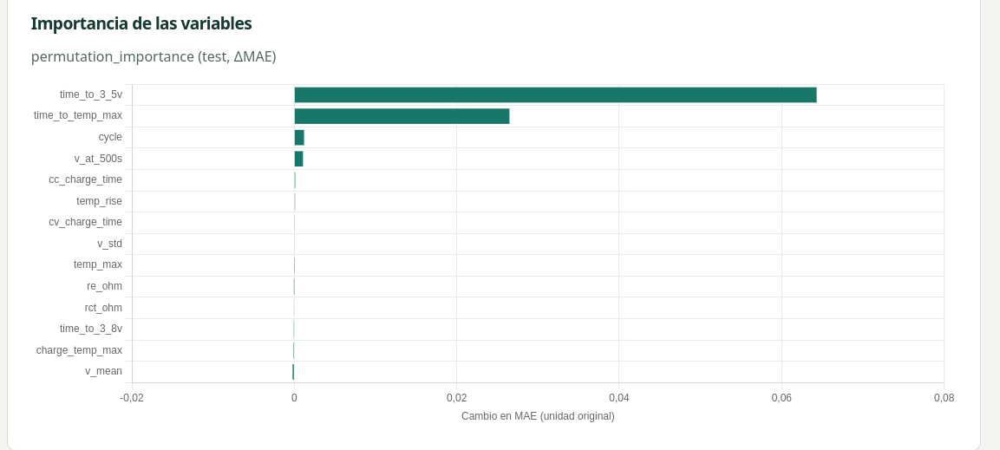

# Informe técnico: Laboratorio de baterías

**Predicción del estado de salud (SOH) y la vida útil restante (RUL) de baterías de ion-litio**

Proyecto final de Fundamentos de IA + Machine Learning. Ingeniería Electrónica, Universidad del Magdalena.
Docente: Rafael David Linero Ramos.
Integrantes: Santiago Cavadia y Andru Fonseca.
Repositorio: <https://github.com/santiagoeduardocavadia-cmyk/ProyectoMachineLearning_SOHstate>

Modalidad: **aplicación web** con backend FastAPI y frontend React, ejecutada localmente.

---

## Índice

1. [Planteamiento del problema](#1-planteamiento-del-problema)
2. [Usuario objetivo y caso de uso](#2-usuario-objetivo-y-caso-de-uso)
3. [Requerimientos](#3-requerimientos)
4. [Arquitectura](#4-arquitectura)
5. [Flujo de usuario](#5-flujo-de-usuario)
6. [Datos y preprocesamiento](#6-datos-y-preprocesamiento)
7. [Componente de machine learning](#7-componente-de-machine-learning)
8. [Validación técnica y funcional](#8-validación-técnica-y-funcional)
9. [Registro de errores, limitaciones y decisiones de mejora](#9-registro-de-errores-limitaciones-y-decisiones-de-mejora)
10. [Consideraciones éticas, de seguridad y de uso responsable](#10-consideraciones-éticas-de-seguridad-y-de-uso-responsable)
11. [Conclusiones y proyección futura](#11-conclusiones-y-proyección-futura)
12. [Reproducibilidad](#12-reproducibilidad)

---

## 1. Planteamiento del problema

Las baterías de ion-litio pierden capacidad con el uso. Se considera que una celda llega al **fin de vida (EOL)** cuando
conserva menos del 70 % de su capacidad nominal. Saber cuánta salud le queda a una batería (**SOH**) y cuántos ciclos
le faltan para el EOL (**RUL**) permite planear el mantenimiento y reemplazarla antes de que falle. También permite no
desechar celdas que todavía sirven.

La capacidad real solo se puede medir con una descarga completa y controlada, que es lenta y saca la batería de
servicio. **La pregunta del proyecto es si se puede estimar el SOH y la RUL a partir de señales más fáciles de obtener**:
la forma de la curva de voltaje, la temperatura, los tiempos de carga y la impedancia.

**Delimitación.** El problema se trata como **regresión supervisada** sobre el *Battery Data Set* de la NASA. Los
datos son cuatro celdas 18650 de 2.0 Ah cicladas a 24 °C, con 636 ciclos de descarga en total. El alcance son
celdas de ese tipo y en esas condiciones. No se pretende generalizar a otras químicas ni a otras temperaturas (ver §9 y §10).

**Justificación académica.** El caso articula los temas del curso:
- preprocesamiento de señales a características;
- prevención de fuga de información;
- modelos supervisados lineales y no lineales;
- evaluación honesta con split por grupo, validación cruzada y línea base;
- comunicación de resultados en una interfaz.

Para Ingeniería Electrónica tiene sentido directo: la estimación de SOH es una función central de un sistema de gestión
de baterías (BMS).

**Justificación técnica.** Un entorno de experimentación es mejor que un notebook aislado, por cuatro razones:
- permite comparar modelos y configuraciones sin reescribir código;
- guarda cada experimento de forma reproducible;
- separa la lógica de ML (backend) de la visualización (frontend);
- deja ver que las decisiones metodológicas tienen efecto en los resultados.

## 2. Usuario objetivo y caso de uso

| Perfil | Necesidad | Qué hace en el sistema |
|---|---|---|
| **Ingeniero o analista de confiabilidad de baterías** (usuario principal) | Saber qué modelo estima mejor el SOH o la RUL de una celda y con qué error | Explora la degradación, entrena y compara modelos, y estima el SOH de ciclos nuevos con valores manuales o un CSV |
| **Estudiante o docente de ML** | Entender cómo cambian las métricas según el modelo, los hiperparámetros, las variables y la batería de prueba | Repite experimentos con distintas configuraciones y lee la metodología |

**Caso de uso principal.** El usuario abre la pestaña *Datos* y observa cómo cae la capacidad de cada batería
hacia el umbral de 1.4 Ah. En *Entrenamiento* elige:
- el objetivo (SOH, RUL o capacidad);
- el modelo y sus hiperparámetros;
- las variables;
- la batería de prueba.

Luego ejecuta. En *Experimentos* compara el error contra la línea base, revisa la validación cruzada y las
gráficas de valor predicho contra real, y consulta la importancia de las variables. Por último hace una inferencia:
el SOH estimado de un ciclo concreto, de valores escritos a mano o de un CSV. El resultado se muestra en porcentaje y
con una etiqueta interpretable: *bueno*, *degradado* o *fin de vida*.

## 3. Requerimientos

### 3.1 Funcionales

| ID | Requerimiento | Dónde se cumple |
|---|---|---|
| RF1 | Consultar el dataset: resumen, catálogo de variables, ciclos paginados y curva de degradación por batería | `GET /dataset/*` · pestaña *Datos* |
| RF2 | Configurar un experimento: objetivo (`soh`, `rul`, `capacity`), modelo, hiperparámetros, variables y baterías de prueba | `POST /experiments` · *Entrenamiento* |
| RF3 | Entrenar y evaluar con split por batería, validación cruzada leave-one-battery-out y línea base | `app/ml/training.py` |
| RF4 | Mostrar métricas (MAE, RMSE, R², MAPE) de train, test, línea base y CV, también por batería | `GET /experiments/{id}` · *Experimentos* |
| RF5 | Graficar el valor predicho contra el real y la importancia de las variables | `GET /experiments/{id}/predictions` y `/feature-importance` |
| RF6 | Inferencia por batería y ciclos, por valores manuales o por un CSV | `POST /experiments/{id}/predict` y `/predict/csv` |
| RF7 | Guardar cada experimento: configuración, métricas, predicciones, modelo y versiones | `backend/experiments/<id>/` |
| RF8 | Listar, comparar, descargar el modelo y borrar experimentos | `GET` y `DELETE /experiments`, `/model` |
| RF9 | Publicar qué modelos hay y los rangos válidos de sus hiperparámetros, para que la interfaz no los tenga fijos en el código | `GET /models` |
| RF10 | Rechazar entradas inválidas con un mensaje explícito | `app/errors.py` (ver §8.3) |

### 3.2 No funcionales

| ID | Requerimiento | Cómo se cumple |
|---|---|---|
| RNF1 | **Reproducibilidad** | `random_state` fijo. Cada experimento guarda las versiones de librerías y una huella SHA-256 del dataset. El CSV procesado está versionado |
| RNF2 | **Modularidad** | Backend y frontend se comunican solo por HTTP con un contrato versionado (API v1.0.0, `CONTEXTO_CHATGPT.md`). El backend tiene capas separadas: datos, ML, persistencia y API |
| RNF3 | **Rendimiento** | Un entrenamiento con CV tarda desde menos de 1 s (Ridge, Gradient Boosting) hasta unos 10 s (Random Forest) en un portátil, así que el usuario puede iterar en vivo |
| RNF4 | **Mantenibilidad** | 11 pruebas automáticas con pytest, que se ejecutan en GitHub Actions en cada push |
| RNF5 | **Usabilidad** | Interfaz en español, con el SOH en %, estados con nombre, la línea base al lado de cada métrica y una pestaña de metodología |
| RNF6 | **Robustez** | Errores con forma JSON uniforme, valores ausentes como `null` (nunca `NaN`), CSV limitado a 5 MB e ID de experimento validado con una expresión regular (evita recorrer rutas del disco) |
| RNF7 | **Portabilidad** | Python 3.10 o superior y Node 22 o superior. Funciona en Windows, Linux y macOS |

## 4. Arquitectura



**Decisiones de arquitectura**

| Decisión | Alternativa descartada | Por qué |
|---|---|---|
| Backend y frontend separados por una API REST | Streamlit o Gradio monolítico | Permite que dos personas trabajen en paralelo con un contrato fijo. Las pruebas de la API no dependen de la interfaz y la API se puede usar sin la interfaz (Swagger, `curl`) |
| Preprocesamiento por lotes con el CSV versionado | Procesar los `.mat` en cada arranque | Los datos crudos pesan unos 210 MB y el procesamiento es determinista, así que se hace una vez y el CSV queda en el repositorio con su huella |
| Persistencia en archivos (JSON, CSV y joblib) | Base de datos | Para un solo usuario local es suficiente, se puede inspeccionar a mano y se versiona con git |
| `Pipeline` de scikit-learn (imputación → escalado → modelo) | Pasos sueltos | Garantiza que la imputación y el escalado se ajusten solo con el entrenamiento, sin fuga de información, y que el modelo guardado incluya todo el preprocesamiento |

## 5. Flujo de usuario



**Pantallas**

| Pantalla | Entradas | Salidas |
|---|---|---|
| Datos | Selección de batería y página | Curva de capacidad por ciclo con el umbral de 1.4 Ah, tabla de ciclos y catálogo de variables |
| Entrenamiento | Objetivo, modelo, hiperparámetros, variables y baterías de prueba | Experimento creado, o errores de validación |
| Experimentos | Selección de experimentos | Tabla comparativa, métricas contra la línea base, CV, valor predicho contra real e importancias |
| Inferencia (dentro del detalle) | Batería y ciclos, valores manuales o CSV | Predicción por fila con su estado |
| Metodología | — | Explicación del split, la línea base, la CV, la selección de variables y el caso de B0007 |

**Evidencia de ejecución**

*Datos: curva de degradación de B0006.* Cruza el umbral de 1.4 Ah en el ciclo 109 y termina con 59.3 % de salud.



*Experimento SOH con Random Forest y test B0006: métricas contra la línea base y validación cruzada.*



*Configuración guardada del experimento: modelo, baterías, semilla, variables e hiperparámetros.*



*Inferencia por batería y ciclo.* La interfaz avisa cuando la batería se usó en el entrenamiento y muestra el resultado
en %, la capacidad estimada y el estado.



Las gráficas de predicciones e importancia de variables están en §8.4.

## 6. Datos y preprocesamiento

El detalle completo está en [`backend/docs/PREPROCESAMIENTO.md`](../backend/docs/PREPROCESAMIENTO.md). Resumen:

**Fuente.** NASA Prognostics Center of Excellence, *Battery Data Set*, subconjunto `BatteryAgingARC-FY08Q4`. Se eligió
porque es público, está citado en la literatura de pronóstico de baterías y tiene ciclos completos hasta el EOL, con
carga, descarga e impedancia.

| Batería | Ciclos de descarga | Voltaje de corte | ¿Llega al EOL? |
|---|---|---|---|
| B0005 | 168 | 2.7 V | Sí |
| B0006 | 168 | 2.5 V | Sí (es la que más se degrada: SOH mínimo de 0.58) |
| B0007 | 168 | 2.2 V | **No**: su RUL queda censurado |
| B0018 | 132 | 2.5 V | Sí |

**Pipeline de datos**



**Decisiones clave**
- **Unidad de análisis:** un ciclo de descarga.
- **Fuga de información evitada:** se excluyen la duración total de la descarga y la energía. A corriente constante,
  `capacidad = 2 A × duración`, así que incluirlas sería darle la respuesta al modelo.
- **Faltantes:** 3 ciclos sin carga previa y 57 sin impedancia válida. Se imputan con la mediana **del entrenamiento**,
  dentro del `Pipeline`.
- **Objetivos:** `soh = capacidad / 2.0` y `rul = ciclo_EOL − ciclo`. Los ciclos posteriores al EOL y B0007 se excluyen de RUL.

## 7. Componente de machine learning

**Tipo de problema:** regresión supervisada.

| Modelo | Por qué se incluye |
|---|---|
| Ridge | Referencia lineal, interpretable y regularizada. Es el único que extrapola la tendencia |
| Random Forest | No lineal y robusto, sin necesidad de escalar. Da importancia de variables |
| Gradient Boosting | Suele dar más precisión en datos tabulares. Es el de referencia para RUL |
| SVR (RBF) | No lineal con kernel. Sirve para comparar con los árboles |
| K vecinos | Basado en similitud. Muestra el efecto de no poder extrapolar |

Los hiperparámetros se validan contra rangos que publica el backend (`GET /models`). Por ejemplo, `n_estimators` debe
estar en [10, 1000].

**Protocolo de evaluación**
1. **Split por batería.** El test es una batería completa que el modelo nunca vio; por defecto B0006, la más exigente. Un
   split aleatorio por ciclo inflaría las métricas, porque dos ciclos consecutivos de la misma celda son casi iguales.
2. **Validación cruzada leave-one-battery-out** sobre las baterías de entrenamiento.
3. **Línea base:** predecir la media del entrenamiento. Un modelo útil debe superarla con claridad.
4. **Métricas:** MAE (en las unidades del objetivo, fácil de interpretar), RMSE (castiga más los errores grandes), R² y MAPE.
5. **Importancia por permutación** sobre el test: cuánto aumenta el MAE al desordenar cada variable.

## 8. Validación técnica y funcional

### 8.1 Métricas del modelo (test = B0006)

| Experimento | MAE test | RMSE | R² | MAE de la línea base | CV (MAE medio ± desv.) |
|---|---|---|---|---|---|
| SOH – Ridge | **0.020** (2.0 pp) | 0.020 | 0.975 | 0.113 | 0.005 ± 0.003 |
| SOH – Random Forest | 0.030 (3.0 pp) | 0.037 | 0.914 | 0.113 | 0.011 ± 0.001 |
| SOH – K vecinos | 0.045 | 0.050 | 0.844 | 0.113 | 0.026 ± 0.007 |
| RUL – Gradient Boosting | **11.4 ciclos** | 13.0 | 0.830 | 27.3 | 20.4 ± 1.0 (2 pliegues) |

Todos los modelos superan la línea base: el MAE baja entre un 60 % y un 83 %. El mejor modelo de SOH se equivoca en
promedio 2 puntos porcentuales sobre una batería que nunca vio.

### 8.2 Sensibilidad a la batería de prueba

Para comprobar que el resultado no depende de haber elegido B0006, se repitió la evaluación con cada batería como test:

| Objetivo · modelo | B0005 | B0006 | B0007 | B0018 |
|---|---|---|---|---|
| SOH · Ridge (MAE) | 0.003 | 0.020 | 0.011 | 0.015 |
| SOH · Random Forest (MAE) | 0.006 | 0.030 | 0.016 | **0.005** |
| SOH · línea base (MAE) | 0.086 | 0.113 | 0.074 | 0.070 |
| RUL · Ridge (MAE, ciclos) | 16.5 | 11.1 | — | 13.2 |
| RUL · Gradient Boosting (MAE, ciclos) | **11.7** | 11.4 | — | **11.7** |
| RUL · línea base (MAE, ciclos) | 32.2 | 27.3 | — | 25.3 |

**Lectura crítica**
- Los modelos superan la línea base en **todas** las baterías, así que la conclusión principal es estable.
- **Qué modelo es "el mejor" depende de la batería de prueba.** Ridge gana en B0005, B0006 y B0007, pero Random Forest gana en
  B0018. En RUL, Gradient Boosting es más estable que Ridge.
- B0006 es la batería más difícil porque se degrada por debajo del SOH mínimo visto en entrenamiento (0.58 contra 0.64).
  Los árboles no extrapolan: su predicción se aplana al final de la curva. Por eso, con B0006 como test, Ridge le gana
  al Random Forest.

### 8.3 Pruebas funcionales

Hay 11 pruebas automáticas (`backend/tests/`), que se ejecutan con `pytest` y en GitHub Actions
(`.github/workflows/backend-ci.yml`). Resultado actual: **11 aprobadas**.

| Prueba | Qué verifica |
|---|---|
| `test_time_to_threshold_interpola` | El tiempo hasta un umbral de voltaje se interpola correctamente |
| `test_discharge_features_ignora_rebote` | Las características ignoran el rebote de voltaje posterior al corte |
| `test_rul_y_censura` | El cálculo de RUL y la censura de una batería que no llega al EOL |
| `test_hiperparametros_validacion` | Se rechazan hiperparámetros fuera de rango o de tipo incorrecto |
| `test_health` | El servicio responde |
| `test_dataset_endpoints` | Resumen, variables, ciclos y degradación del dataset |
| `test_models` | El catálogo de modelos e hiperparámetros |
| `test_experimento_punta_a_punta` | Crear, consultar, predecir, descargar y borrar un experimento |
| `test_rul` | Un experimento de RUL excluye B0007 y emite el aviso |
| `test_errores_de_entrada` | Modelo, variables o split inválidos, campos extra, experimento o ciclo inexistente, intento de recorrer rutas (`../../etc`), muestras incompletas y CSV inválido o con otra extensión |
| `test_cors` | El frontend puede llamar a la API desde otro origen |

Las pruebas usan una carpeta temporal de experimentos para no ensuciar `backend/experiments/`.

**Ejemplo de manejo de errores** (entrada inválida → respuesta explícita):

```json
POST /api/v1/experiments   {"model_type": "random_forest", "hyperparameters": {"n_estimators": 5}}
→ 422
{"error": {"code": "invalid_hyperparameters",
           "message": "Hiperparámetros fuera de rango o con tipo inválido.",
           "details": [{"field": "n_estimators", "message": "debe estar en [10, 1000]"}]}}
```

Otros códigos verificados por las pruebas: `validation_error`, `unknown_model`, `invalid_split` (todas las baterías en test,
o RUL con B0007 como test), `invalid_features`, `experiment_not_found`, `cycle_not_found`, `invalid_samples` e `invalid_file`
(CSV vacío, columnas no numéricas o archivo que no es `.csv`). El backend también define `battery_not_found`,
`file_too_large` (CSV de más de 5 MB) e `internal_error`.

**Verificación de flujos de usuario** (manual, en el navegador):

| Flujo | Resultado esperado | Resultado obtenido | Estado |
|---|---|---|---|
| Ver la degradación de B0006 | La curva cruza la línea de 1.4 Ah | Cruza en el ciclo 109 y termina en 59.3 % de salud (captura en §5) | ✅ Interfaz |
| Entrenar SOH con Random Forest y test B0006 | Métricas visibles y guardadas | MAE 0.030, R² 0.914 y línea base 0.113. Se guardan la configuración y la semilla (capturas en §5) | ✅ Interfaz |
| Inferencia por batería y ciclo | Predicción con su estado | B0005, ciclo 100: 74.37 % predicho contra 74.29 % real, *degradado*. Muestra el aviso de que la batería se usó en el entrenamiento | ✅ Interfaz |
| Comparar Ridge contra Random Forest | Ridge con menor MAE | Ridge 0.0195 contra RF 0.0301 | ✅ API |
| Inferencia con un CSV (`docs/ejemplo_inferencia.csv`) | Predicción por fila con su estado | 5 filas de B0006 predichas. Avisa que imputó 2 valores nulos | ✅ API |
| Hiperparámetro inválido (`n_estimators = 5`) | Error explícito y no se crea el experimento | HTTP 422 `invalid_hyperparameters`: "debe estar en [10, 1000]". El número de experimentos no cambia | ✅ API |

Los tres primeros flujos se verificaron en la interfaz. Los tres últimos se verificaron contra la API en ejecución, que es
la misma que usa la interfaz.

### 8.4 Evidencia visual del comportamiento del modelo

*Predicciones por ciclo (Random Forest, test B0006).* La predicción sigue bien la curva real hasta un SOH de unos 65 % y
**después se aplana**, mientras la batería real sigue bajando hasta 58 %. Es la limitación de extrapolación de los
árboles descrita en §8.2.



*Valor predicho contra real y residuales.* Por debajo de 65 % real, los puntos forman una línea horizontal y los residuales
crecen hasta +7 pp al final de la vida: el modelo **sobrestima** la salud justo cuando la batería está peor. Ese es el
error más riesgoso (ver §10). Al inicio también hay un sesgo negativo: el modelo subestima las celdas casi nuevas.



*Importancia por permutación.* `time_to_3_5v` y `time_to_temp_max` concentran casi toda la importancia, y ambas tienen
sentido físico (§6). Varias variables aportan casi nada, así que un modelo con menos variables podría rendir igual.



### 8.5 Resultado del caso de inferencia por CSV

Modelo `referencia_soh_ridge` sobre `docs/ejemplo_inferencia.csv` (B0006):

| Ciclo | SOH real | SOH predicho | Estado real | Estado predicho |
|---|---|---|---|---|
| 1 | 101.8 % | 98.9 % | bueno | bueno |
| 50 | 88.8 % | 86.9 % | bueno | bueno |
| **100** | **71.6 %** | **69.4 %** | **degradado** | **fin de vida** ⚠️ |
| 150 | 62.7 % | 61.1 % | fin de vida | fin de vida |
| 168 | 59.3 % | 58.3 % | fin de vida | fin de vida |

Un error de solo 2.2 pp en el ciclo 100 cambia la etiqueta, porque el valor real está cerca del umbral de 70 %
(ver §9, hallazgo 10).

## 9. Registro de errores, limitaciones y decisiones de mejora

| # | Hallazgo | Tipo | Decisión |
|---|---|---|---|
| 1 | Con B0006 como test, Random Forest y K vecinos aplanan la predicción al final de la curva | Limitación del modelo | Se documenta (los árboles no extrapolan). Se incluye Ridge como contraste. A futuro: modelos con tendencia o híbridos físico-estadísticos |
| 2 | El ranking de modelos cambia según la batería de prueba (§8.2) | Limitación de evaluación | No se declara un "ganador" absoluto. A futuro: reportar en la interfaz el promedio sobre todas las baterías |
| 3 | La validación cruzada de RUL solo tiene 2 pliegues, porque B0007 está censurada | Limitación de datos | Se informa con un aviso (`warnings`) y se interpreta con cautela |
| 4 | La RUL tiene un MAPE alto (31 %) aunque el MAE sea bajo | Comportamiento de la métrica | Cerca del EOL la RUL real es pequeña y el error relativo se dispara. Para RUL se prioriza el MAE en ciclos |
| 5 | Hay sobreajuste visible: Random Forest tiene MAE 0.001 en train y 0.030 en test | Riesgo metodológico | Se detecta gracias al split por batería y la CV. Por eso nunca se reporta la métrica de train como resultado |
| 6 | El rebote de voltaje tras el corte de descarga contaminaba las características | Error corregido en el preprocesamiento | Se corta en el voltaje mínimo. Lo cubre `test_discharge_features_ignora_rebote` |
| 7 | 57 ciclos sin impedancia válida y valores Re/Rct corruptos | Calidad de datos | Re y Rct deben estar en (0, 1) Ω. Se imputan con la mediana del entrenamiento dentro del `Pipeline` |
| 8 | Un modelo guardado con otra versión de scikit-learn puede dar advertencias al cargarse | Reproducibilidad | Se guardan las versiones de librerías. Script `run_reference_experiment` para regenerarlo |
| 9 | Las predicciones no traen intervalo de confianza | Limitación funcional | A futuro: intervalos con regresión por cuantiles o *conformal prediction* |
| 10 | Cerca de los umbrales (85 % y 70 %), un error pequeño cambia la etiqueta de estado. B0006, ciclo 100: real 71.6 % (*degradado*), predicho 69.4 % (*fin de vida*) (§8.5) | Limitación de interpretación | A futuro: marcar como "zona de incertidumbre" los resultados a menos de un MAE del umbral, en vez de dar una etiqueta tajante |
| 11 | El Random Forest sobrestima el SOH hasta +7 pp al final de la vida de B0006 (§8.4) | Riesgo de seguridad | Se documenta en §10. Para baterías muy degradadas conviene usar Ridge o un modelo que extrapole |

## 10. Consideraciones éticas, de seguridad y de uso responsable

**Sesgo y representatividad de los datos.** El modelo aprendió de **cuatro celdas del mismo tipo, a 24 °C, con descargas
de corriente constante a 2 A**. Las baterías reales trabajan con temperaturas, corrientes variables, profundidades de
descarga y fabricantes distintos. Fuera de esas condiciones las predicciones **no están validadas**, y el sistema
podría equivocarse sin dar ninguna señal.

**Riesgo físico.** Sobrestimar el SOH es el error más peligroso. Si el modelo dice que una celda degradada está sana,
se puede seguir usando y aumenta el riesgo de falla o embalamiento térmico. Por eso:
- el sistema es una **herramienta de apoyo y de experimentación**, no un BMS certificado;
- **no debe ser el único criterio** para reemplazar una batería ni para decidir si es segura;
- al leer una predicción hay que tener presente el error esperado del experimento (su MAE en el test), para no darle
  falsa precisión. Mostrarlo junto a cada predicción en la interfaz es una mejora recomendada.

**Extrapolación.** Cuando una celda se degrada más allá de lo visto en el entrenamiento (B0006), los modelos de árboles
subestiman la degradación: el Random Forest llegó a sobrestimar el SOH en unos 7 pp al final de la vida (§8.4). Un uso responsable implica avisar al usuario cuando la entrada está fuera del rango
de entrenamiento; esta función queda como mejora pendiente.

**Impacto económico y social.** Una buena estimación puede extender la vida útil, permitir usos de "segunda vida" y
reducir residuos. Una estimación mal usada, por ejemplo en garantías o en la reventa de baterías usadas, podría
perjudicar a quien compra o a quien vende. Las decisiones con consecuencias económicas deben respaldarse con una
medición directa de la capacidad.

**Seguridad del software.**
- Está pensado para ejecución **local y de un solo usuario**: no tiene autenticación y el CORS está abierto (`*`). Para
  desplegarlo en red habría que restringir los orígenes (`BATT_CORS_ORIGINS`) y añadir autenticación.
- Los modelos se guardan con `joblib` (pickle). **Cargar un `.joblib` de un tercero puede ejecutar código arbitrario.**
  El sistema solo carga los modelos que él mismo generó; no se deben cargar modelos de origen desconocido.
- Las entradas se validan: el CSV está limitado a 5 MB y debe tener columnas numéricas, los IDs de experimento siguen un
  patrón restringido (evita recorrer rutas del disco) y los hiperparámetros tienen rangos.

**Transparencia en el desarrollo.** Parte del código y la documentación se desarrolló con asistentes de IA generativa:
Claude en el backend y ChatGPT en el frontend, según `README.md`. El equipo revisó, ejecutó y validó el sistema y
responde por las decisiones técnicas que se sustentan.

**Datos personales.** El dataset no contiene datos personales y es de uso público.

## 11. Conclusiones y proyección futura

**Conclusiones**
1. Es posible estimar el SOH de una batería que el modelo nunca vio con un error medio de unos 2 puntos porcentuales,
   usando solo características indirectas y sin medir la capacidad.
2. La RUL es más difícil: unos 11 ciclos de error y una validación cruzada débil, con R² de 0.52 y solo 2 pliegues. Con
   4 baterías, la evidencia para RUL es limitada.
3. Las decisiones metodológicas pesan más que el modelo elegido. Un split aleatorio o incluir la duración de la descarga
   darían métricas casi perfectas pero falsas.
4. Ningún modelo gana en todas las baterías. Un modelo lineal simple puede superar a uno más complejo cuando hay que
   extrapolar.

**Proyección futura**
- Incorporar más celdas y condiciones: otros subconjuntos NASA, CALCE, Oxford y distintas temperaturas.
- Añadir intervalos de predicción y avisos de entrada fuera de rango.
- Probar modelos secuenciales (LSTM o GRU) sobre la historia de ciclos, y modelos híbridos con física de degradación.
- Reportar en la interfaz métricas promediadas sobre todas las baterías de prueba.
- Agregar autenticación si se despliega en red.

## 12. Reproducibilidad

```bash
# Backend
cd backend
python -m venv .venv && source .venv/bin/activate      # Windows: .venv\Scripts\activate
pip install -r requirements.txt
uvicorn app.main:app --reload --port 8000               # Swagger: http://localhost:8000/docs
pytest -q                                               # 11 pruebas

# Frontend (otra terminal)
cd frontend
npm ci
npm run dev                                             # http://localhost:5173

# Opcional: regenerar el dataset desde los datos crudos de la NASA (unos 210 MB)
cd backend && python -m scripts.prepare_dataset
```

Cada experimento guarda su configuración completa, las versiones de librerías y la huella del dataset en
`backend/experiments/<id>/experiment.json`. Con eso se puede volver a ejecutar en otro equipo y comparar los resultados.
